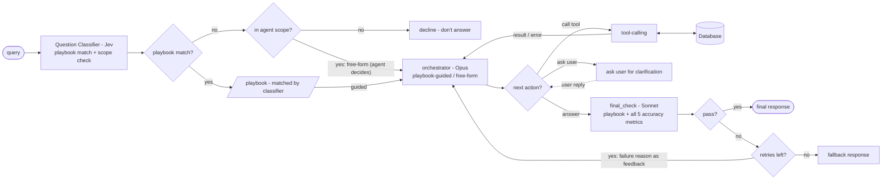

# Spec: agentic-loop v2 (production)

Source: the "agentic-loop v2 (production)" page of the Lucid doc "prd agentic loop". Ignore the v1 page.

## 1.1 Diagram as Mermaid (source of truth for this skill)

## 1.2 Nodes (16)

| ID | Node | Kind | Responsibility |
|----|------|------|----------------|
| N1 | `query` | input | Incoming user query. |
| N2 | `question_classifier` (Jev) | process | One call that does both the **playbook match** and the **scope check**. Returns `{playbook_id \| null, in_scope: bool}`. |
| N3 | `playbook_match?` | decision | Branch on `playbook_id != null`. |
| N4 | `in_agent_scope?` | decision | Branch on `in_scope`. Only reached when there is no playbook match. |
| N5 | `decline` | terminal | Don't answer. No orchestrator call, no tool call. |
| N6 | `playbook` | document | Load the playbook the classifier matched. |
| N7 | `orchestrator` (Opus) | process | Runs in one of two modes: **playbook-guided** (from N6) or **free-form** (from N4). Decides the next action. |
| N8 | `next_action?` | decision | Exactly one of: `call_tool`, `ask_user`, `answer`. |
| N9 | `tool_calling` | process | Runs the tool the orchestrator chose. Reads from and writes to the Database. |
| N10 | `database` | store | Data the tools read and write (two-way). |
| N11 | `ask_user_for_clarification` | process | Pauses the run, sends a question to the user, and resumes with their reply. |
| N12 | `final_check` (Sonnet) | process | Checks the candidate answer against the playbook (if there is one) **and all 5 accuracy metrics**. Returns `{pass: bool, failure_reason}`. |
| N13 | `pass?` | decision | Branch on `pass`. |
| N14 | `retries_left?` | decision | Branch on whether there are retries left. |
| N15 | `final_response` | terminal | The answer that passed the check goes to the user. |
| N16 | `fallback_response` | terminal | Safe response when retries run out. |

## 1.3 Edges (18) — every one must exist in code, and nothing else

| ID | From → To | Condition / payload |
|----|-----------|---------------------|
| E1 | query → question_classifier | raw query |
| E2 | question_classifier → playbook_match? | classifier result |
| E3 | playbook_match? → playbook | **yes** |
| E4 | playbook_match? → in_agent_scope? | **no** |
| E5 | in_agent_scope? → decline | **no** |
| E6 | in_agent_scope? → orchestrator | **yes**, mode = `free_form` (the agent decides) |
| E7 | playbook → orchestrator | mode = `guided`, playbook content in context |
| E8 | orchestrator → next_action? | orchestrator decision |
| E9 | next_action? → tool_calling | **call tool** |
| E10 | tool_calling ↔ database | reads and writes |
| E11 | tool_calling → orchestrator | **result / error**: both come back to the orchestrator as data, never as an uncaught exception |
| E12 | next_action? ↔ ask_user_for_clarification | **ask user**; the user's reply goes back into the orchestrator's context |
| E13 | next_action? → final_check | **answer** (candidate answer) |
| E14 | final_check → pass? | check result |
| E15 | pass? → final_response | **yes** |
| E16 | pass? → retries_left? | **no** |
| E17 | retries_left? → orchestrator | **yes**, with the **failure reason as feedback** |
| E18 | retries_left? → fallback_response | **no** |

## 1.4 Invariants (these follow from the diagram; none may be broken)

1. Nothing reaches `final_response` without going through `final_check` and getting `pass = yes`. This holds in both guided and free-form mode.
2. `decline` happens only when there is no playbook match **and** the query is out of scope. A matched playbook skips the scope check.
3. The orchestrator and `final_check` are separate calls on separate models (Opus and Sonnet). The orchestrator never grades its own answer.
4. A tool error goes back to the orchestrator as a result (E11). It never ends the run.
5. A retry always carries `final_check`'s failure reason into the orchestrator's next turn (E17).
6. `fallback_response` is reached **only** when the check failed and there are no retries left.
7. Every run ends in exactly one of three terminal nodes: `decline`, `final_response` or `fallback_response`. It can also be paused, waiting in `ask_user_for_clarification`.
